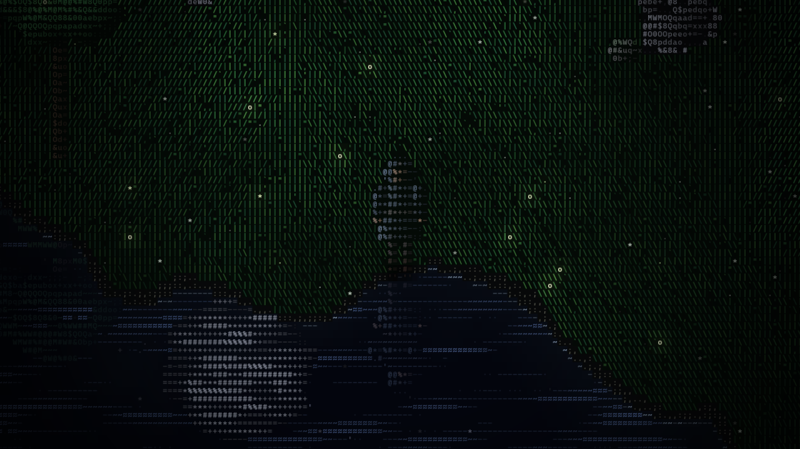

# ASCII Realm

A browser game rendered entirely in ASCII characters. Every frame is a grid of
coloured glyphs: grass is made of `\ | /` blades that sway in the wind, water is
streaked with `- ~ ≈` ripples and reflects whatever stands on the shore, and the
player is a hooded outlaw drawn from hundreds of shaded characters.

**Play:** https://justinasla.github.io/ascii-realm/



For now it is a single outlaw exploring procedurally generated terrain.

## Features

- **One-pass WebGL2 renderer.** The CPU fills a cell buffer (glyph + colours);
  a fragment shader draws every glyph from a font atlas, so the screen can hold
  tens of thousands of characters at full frame rate.
- **Infinite seeded world.** Lakes, shoreline, meadows, dirt paths and rocky
  outcrops from layered noise, generated in 64×64 chunks as you walk. Add
  `?seed=42` to the URL for a different world.
- **Living grass.** Blades lean with rolling gusts, flash lighter where the wind
  catches them, part around your feet, and hide twinkling dew drops.
- **Water.** Drifting ripple streaks, lapping foam, and a night sky (stars and
  the moon) mirrored in every lake.
- **Reflections.** The wanderer, trees and boulders are mirrored about their own
  base, so the reflection only appears where it would actually reach the water,
  then sways and breaks into slivers with the swell.
- **The outlaw.** A lean, hooded archer in the mould of Robin Hood: a 3D
  skeleton posed every frame, turned to any heading and dressed in a pointed
  hood with a dagged shoulder cape and a shadowed face, a green wool tunic
  under a laced leather jerkin, hose, tall cuffed boots, bracers, a quiver of
  fletched arrows and a longbow across the back, a short sword on the hip and
  a simulated cloak. Every part is rasterised into glyphs with supersampling:
  outlines follow the silhouette with a moonlit rim, and each material (wool,
  leather, wood, feather, iron) has its own glyph texture.
- **Animation.** The player is a rigged 3D character playing professionally
  animated clips, drawn each frame into a small offscreen image from the
  game's camera angle and converted into shaded, outlined glyphs. Walk, jog
  and sprint clips are blended by speed and kept in step with the ground, so
  the feet keep pace with the body.
  An idle stance that shifts its weight and looks around, then kneels to
  rest; blinking eyes and breath fogging in the cold air; jumping with a
  wind-up and landing squash; a skid to a halt from a sprint; and sword play:
  draw, guard, a combo (forehand, then backhand or uppercut, then an overhead
  chop that strikes sparks, shakes the camera and freezes for a beat on
  impact), a lunging thrust from a sprint, a plunging strike from the air and
  a charged spinning slash, all with glowing swing trails. Footsteps kick up
  dust and grass and leave prints in dirt and sand.
- **Nameplate.** The warrior's name floats above the helm; add `?name=...` to
  the URL to choose it.
- **Atmosphere.** Fireflies, a vignette, and zoom.

## Running

No build step. Serve the folder with any static file server and open it:

```sh
python -m http.server 8000
# then open http://localhost:8000
```

A browser with WebGL2 is required.

The rig and gait have unit tests (Node 18+, no dependencies):

```sh
npm test
```

## Controls

| Key | Action |
| --- | --- |
| `W A S D` / arrow keys | Walk |
| `Shift` | Run |
| `Space` | Jump |
| `J` / left click | Strike: repeat for a combo, sprint for a thrust, jump for a plunge |
| Hold `J` / left click | Charge, then release for a spinning slash |
| `F` | Draw or sheathe the sword |
| Mouse wheel / `+` `-` | Zoom |
| `B` | Enter the Scenery builder, or return to play and close its panel |

## Scenery builder

Press `B` to enter build mode and open the testing panel; press it again to return
to play. You can also open the panel by clicking its summary, then choose
**Start building**. Paint grass, dirt, shore, water or stone with terrain brushes,
or choose from the **Nature** and **Camp** prop palettes: trees, pines, rocks,
bushes, stumps, logs, flowers, mushrooms, reeds, crates, barrels, fences, tents,
campfires and signposts. Flowers, mushrooms and reeds are decorative and can be
walked through; the other props block movement. Adjust the brush radius or prop
scale in the panel and preview props before placing them; the eraser removes
props only. Every placement gets a fresh variation in shape, proportions and
color; rocks also vary their outline, mineral colors and moss. The preview shows
the variation you will place, and saving or undoing preserves its appearance.
While building, `W A S D` pans the view and normal player movement
is paused. With the canvas or page body focused, `Enter` applies the selected
tool at the centre of the view.

Each stroke can be undone with `Ctrl`/`Cmd` + `Z` and redone with
`Ctrl`/`Cmd` + `Shift` + `Z` or `Ctrl` + `Y`. **Save** and **Load** keep scenery
locally for the current world seed. JSON export and import let you transfer a
scene; imports must match the current seed. **Reset scene** restores the
generated world and can be undone.

Add `?builder` to the URL to open the panel automatically. With `?debug`, the
current scene is available as `window.game.builder.scene` for inspection.

## Layout

```
src/
  main.js            game loop and wiring
  core/              input, hashing, noise
  editor/            scenery builder controls, scene history and persistence
  render/            glyph atlas, WebGL renderer, cell writers
  world/             terrain, grass and water shading, props, sky, reflections, fireflies, dust
  entities/          the outlaw: skeleton, clothing, materials, cloak, combat, movement
```

## Credits

Walk and run motion from the [CMU Graphics Lab Motion Capture
Database](http://mocap.cs.cmu.edu/) (subjects 8 and 9), via the BVH
conversion by Bruce Hahne ([cgspeed](https://sites.google.com/a/cgspeed.com/cgspeed/motion-capture/the-daz-friendly-bvh-release-of-cmus-motion-capture-database)).
The database was created with funding from NSF EIA-0196217.

The player character and its idle, walk, jog, jump and sword animations are
from Quaternius' [Universal Animation Library](https://quaternius.com/packs/universalanimationlibrary.html)
(CC0), rendered with [three.js](https://threejs.org/) (MIT, vendored in
`vendor/three`).
