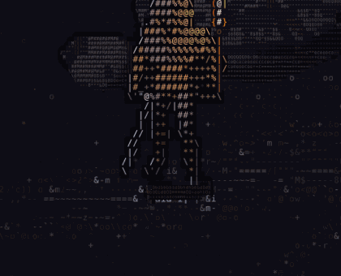
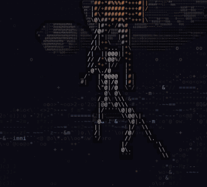

# The game in detail

Everything ASCII Realm draws, animates and plays, system by system. For the
short version see the [README](../README.md).

- **Rune casting.** 44 rune spells across four elements: 10 Oseni (fire), 12
  Seithr (ice), 12 Cerrith (life) and 10 Mitlan (water and storm), from Fire
  Shard, Meteor, Rekindle and Ring of Fire to Frozen Tomb, Vine Wave, Maelstrom and
  Lightning. Hold the middle mouse button to open the rune wheel, point at a
  school and then at one of its runes, and let go: that rune stays bound to
  `R` until another is chosen, even across reloads. Aim with the cursor and
  press `R` or right click. Runes have no cooldown: any rune can be cast again
  at once while there is mana for it, except Ring of Fire, which recharges for
  twenty seconds. The wheel shows each rune's mana cost and damage or
  healing, and binding a rune names it in a notice. Mana shows as the MP bar
  in the status frame.
  On touch screens, hold CAST to open the wheel and tap CAST to cast. Mana
  refills slowly a second after the last cast. Projectiles, waves, zones, shields, heals,
  status effects, summons and channels share one simulation that strikes the
  monsters in the world. Every rune has its own ASCII animation for casting,
  travel and impact, and its own layered recorded foley. Support spells
  such as Healing Orb or Mana Transfer need another player in range.
  Add `?spell=fire-shard` (or another rune's id) to start with that rune
  chosen. The [casting arena](casting-simulation.html) has stationary
  enemy and ally targets, a wall toggle, practice spells and manual time
  stepping. Class abilities are outside this batch. See
  [rune casting](spellcasting.md) and
  [spell presentations](spell-presentations.md).

- **One-pass WebGL2 renderer.** The CPU fills a cell buffer (glyph + colours);
  a fragment shader draws every glyph from a font atlas, so the screen can hold
  tens of thousands of characters at full frame rate.
- **Trees and rocks in finer letters.** Trees and boulders are drawn on a
  second, finer grid, two small characters across and down each cell, over a
  near-black silhouette. They read as dense masses of small letters with a hard
  edge against the grass, ringed by a thin outline of empty night that fades
  out where they meet the ground, so they stay planted in it. A trunk's foot is
  modelled as one solid with its roots and lit by the moon. Anything in front
  of them (the outlaw, grass, rain, fireflies) is still drawn over them, and
  over their outline, in painter's order. Their fine
  versions are baked by web workers once they come near the view; until a
  tree's is ready it is drawn in ordinary cells. Reflections stay in ordinary
  cells.
- **Infinite seeded world.** Lakes, shoreline, meadows, dirt paths and rocky
  outcrops from layered noise, generated in 64×64 chunks as you walk. Add
  `?seed=42` to the URL for a different world.
- **Rivers.** Streams rise on high ground and run downhill until they reach
  a lake or settle in a small pond, from a couple of rows wide at the spring
  to about a dozen further down. Each has a deep middle, shallows, a sandy
  bank and a damp valley floor, and the odd stone stands out of its wider
  reaches. Rivers never cross the starting ruins or the ground around them.
  Grass on the bank facing you stays low so it does not hide the water.
- **Living grass.** Two- and three-row path verges blend into fuller meadows
  and lakeshore reeds, with blades up to five cells high.
  Fine blades, leafy tufts, curved grass, seed heads and dry gold patches give
  each meadow a different texture and palette.
  Rolling gusts move the tips more than the roots and catch them with a pale
  sheen. Planted boot soles press exact footprints into the grass for several
  seconds; repeated footfalls keep a worn route flattened longer. Sword swings
  push blades aside too. Shoreline stems sway in their reflections
  too. Dew twinkles in the undergrowth.
- **Living forests.** Eight distinct trees inspired by Minecraft's variety:
  oak, pale-barked birch, pine, tiered spruce, umbrella-shaped acacia, tall
  jungle trees, pink cherry groves and drooping willows near lakes. Mature
  trees tower over the warrior, with varied heights, irregular leaf clusters,
  branching trunks and shaded canopy pockets. Smaller saplings and walkable
  shrubs grow between the widely spaced mature trees. Fine character strokes
  fan into layered sprays on uneven boughs, with curved stems, smaller side
  shoots, open pine whorls and willow curtains starting on individual branches.
  Trunks vary independently from slender stems to thick old trees. Mossy
  fallen logs, snapped bare trunks, exposed stumps, and beaver-gnawed wood
  with scattered chips add history to the forest; beaver damage stays near
  water. Fallen trunks block their full length, including across chunks.
  Layered foliage has shaded depth and moonlit edges; crowns rustle and gently
  sway with the grass, while trunks and roots stay planted. Every tree casts
  a soft moon shadow on the meadow under its crown, lobed like the crown and
  leaning a little away from the moon: the ground, the grass and flowers in
  it are darker, blades there lose their pale moonlit tips, and overlapping
  crowns shade deeper, down to a floor that keeps the grass readable. The
  shadows stay put as you walk and zoom and do not sway with the crowns.
  Bare winter crowns cast only a thin shadow, burning trees less as they
  burn, and felled or burnt ones none; cloud thins them and lightning lifts
  them for its flash. Water, torchlight, firelight and spell light are not
  dimmed by them. Here and there a pale moonbeam reaches the meadow: the
  ground and grass where it lands are brighter and paler, toward the
  moonlight's blue-white, in a soft lobed patch, and above it a faint column
  of lit air leans up toward the moon with a few motes of dust sinking
  down it. Beams stay put as you walk and zoom, are the same on every
  device, never land on water, fade under cloud, wash out in a lightning
  flash and are dimmed under trees. Flowers in a beam brighten but keep
  their colours. Desktops show up to six at once, phones up to four, and a
  phone running at its reduced cell budget up to two, with the patches but
  not the columns. Leaves and blossoms
  drift down, and foliage thins around the warrior when it would hide them.
  Add `?season=spring`, `?season=autumn` or `?season=winter` for seasonal
  palettes and snow-tipped evergreens. Summer is the default; the season
  stays fixed until reload and can be combined with `?seed=42&season=autumn`.
- **Woodland density.** The world's woods are sparse by default: mature
  trees stand alone or in loose groups on grass-only meadows. Two URL
  parameters change that, and both stay fixed until reload:
  - `?flora=1` grows wild flowers, ferns and cattails among the grass, in
    drifts of one species; `?flora=0` keeps the grass alone.
  - `?woodland=dense` grows a grove around every mature tree. The grass
    around the trunk grows taller and fuller, in a ragged sward that leans
    toward the shade the moon leaves, with drifts of forget-me-nots,
    bluebells, cornflowers, daisies and yarrow. Clusters of pale caps grow
    around the trunk, larger near each cluster's heart, and the ground on the
    line between two neighbouring trunks stays open to walk through. The
    trees themselves are the sparse world's. Dense woods bring the flowers
    unless `?flora=0` is added.
  Dense woods are for solo play: lobbies share one world, so a page opened
  with a lobby code plays the sparse woods, and creating or joining a lobby
  from dense woods first reloads the page into the sparse world, keeping
  the lobby server you named, and makes the request there (once the
  character creator, if open, is closed). Saved
  scenery works in both: generated props keep their ids, and an erased grove
  prop is simply not there in the sparse world.
- **Water.** Drifting ripple streaks, lapping foam, and a night sky (stars and
  the moon) mirrored in every lake. Walk or run through any lake: the water
  rises from your ankles to at most your knees, slows your stride, and hides
  the submerged boots. Each footfall throws up droplets and spreading rings;
  jumps, landings and sword impacts make larger splashes.
  Rivers run: pale foam streaks travel downstream at the water's own speed,
  faster in the narrows and slower on bends and by the banks, with riffles
  over fast shallows, froth heaped on the outer bank of a bend, and a V-shaped
  wake and a slowly turning eddy behind each midstream stone. Leaves float
  down with the current, splash rings and spray are carried along, and lakes
  stay calm. Standing or wading in a river, you and any monster are gently
  carried downstream, about a quarter of a walking pace in the middle of an
  ordinary reach, more in the deep narrows; you can always wade upstream, and
  a jump lifts you clear of the push.
  Now and then, roughly every 20 to 60 seconds while you are near running
  water (twice as often during and for three minutes after a heavy storm),
  something comes down the river: a fallen log, a leafy branch (bare in
  winter), a mat of leaves (twigs and straw in winter), a clump of reeds with
  cattail heads, or rarely a broken crate board or barrel stave. It appears
  upstream, off the screen where it can, and drifts at the water's own pace,
  turning to lie along the current and swinging wide on bends. It bobs slowly,
  bumps and slides along the banks and midstream stones with a small ring of
  ripples, sometimes snags for a few seconds on the outer bank of a bend or
  on a stone until the water swings it free, and throws foam and a V-shaped
  wake when the water runs past it. Carried into a lake it slows, soaks up
  and sinks. Only a few pieces are afloat at once (four, six after a storm),
  and nothing too long for a reach comes down it, so the narrowest brooks
  carry only leaves and reeds, or nothing. Wading into a piece shoves it
  away, harder the faster you go and the lighter it is: a mat of leaves or a
  branch flies off, a log only gives way and coasts on, and one struck off
  its middle turns. Monsters wading after you or fleeing shove it the same
  way, and pieces knock into each other. A piece drifting into someone in
  the water bumps them a little sideways with a small splash; a heavy log in
  a fast current is felt, a troll barely notices. A jump clears your feet of
  it, and a hard enough shove frees a snagged one. Shoved out to a bank, a
  piece lies there a moment, then edges back into the current. Debris is
  drawn in small letters with its reflection, never stops or hurts anyone,
  and is never saved: each player sees their own, and only they and the
  monsters shove it.
  Rocks and the stones in a riverbed catch torch, fire and bright spell light
  by the way they face: the side turned to the light lights up warm, the
  back keeps its cool moonlit grey, and wet stones (midstream stones, and
  bed stones breaking the surface) throw small warm glints; stones under
  the water catch less of it, rocks beside the water a little sheen, dry
  rocks a faint one.

  
  

- **Reflections.** The wanderer, trees and boulders are mirrored about their own
  base, so the reflection only appears where it would actually reach the water,
  then sways and breaks into slivers with the swell.
- **The outlaw.** A lean, hooded archer in the mould of Robin Hood: a 3D
  skeleton posed every frame, turned to any heading and dressed in a pointed
  hood with a dagged shoulder cape and a shadowed face, a green wool tunic
  under a laced leather jerkin, hose, tall cuffed boots, bracers, a quiver of
  fletched arrows and a longbow across the back, a short sword on the hip and
  a simulated cloak. Every part is rasterised into glyphs with supersampling:
  outlines follow the silhouette with a moonlit rim, and each material (wool,
  leather, wood, feather, iron) has its own glyph texture. The active
  character's [skin](characters.md#skins) colours the clothes and can lower
  the hood or take off the jerkin or cloak; without one the outlaw looks as
  described here.
- **Animation.** The player is a rigged 3D character playing professionally
  animated clips, drawn each frame into a small offscreen image from the
  game's camera angle and converted into shaded, outlined glyphs. Walk and
  jog clips are blended by speed and kept in step with the ground, so
  the feet keep pace with the body.
  An idle stance that shifts its weight and looks around, then kneels to
  rest; blinking eyes and breath fogging in the cold air; jumps from motion
  capture that suit the pace (a hop on the spot, a leap off one foot from a
  walk, a long split leap from a run), with jumps on the spot in a row
  turning into a forward spring and then a full turn, and a second press in
  the air for a trick: a back somersault on the spot, a spin from a walk and
  a barrel roll from a run; a skid to a halt from a sprint; and sword play:
  draw, guard, a combo (forehand, then backhand or uppercut, then an overhead
  chop that strikes sparks, shakes the camera and freezes for a beat on
  impact), a lunging thrust from a sprint, a plunging strike from the air and
  a charged spinning slash, all with glowing swing trails. Footsteps kick up
  dust and grass and leave prints in dirt and sand.
- **Nameplate.** The active character's name floats above the hood (Kael with
  no character; `?name=...` shows another for testing). Its colour is your
  name colour (see Multiplayer).
- **Atmosphere.** Fireflies, a vignette, and zoom.
- **Status frames and quick slots.** A party-style frame in the top-left
  corner shows the character's name, segmented HP and MP bars and the satchel's weight.
  Nine quick slots sit along the bottom. Running and sword strikes have no stamina cost.
- **Inventory and equipment.** A keyboard-controlled satchel, a seven-slot
  equipment view drawn with the outlaw's own glyphs, item details, 24 bag slots
  and a 60 kg carrying limit. The bag starts with a short sword, equipped and
  assigned to quick slot 1, and a stone pickaxe on quick slot 2. You can move the sword into the bag, equip it
  again and assign it to other quick slots. Clothes are part of the character;
  the torch is carried separately from the inventory. Opening the inventory
  blocks movement and attacks while the world, including enemies, keeps running.
- **Sword and scenery.** The short sword is the available weapon. It is drawn
  on the first strike and put away after a quiet spell standing still (`F`
  draws or sheathes it on a keyboard). Chain cuts into a combo, lunge from a
  run, plunge from a jump or hold and release for a spinning slash. Three sword blows fell a tree,
  leaving a stump, and cuts mow tall grass. Felled trees and cut plants stay
  that way for the session, even after the land has been unloaded and generated
  again. Cutting plants and felling trees gives no logs, berries or fibre; only
  ore veins can be gathered (see Mining).
- **Mining.** Ore veins lie on the land: tight clusters of fist-high ore blocks,
  drawn small like other rocks, in stone tinted by the local rock (dark basalt,
  grey granite, pale limestone) with clumps of the ore's colour. A chunk has up
  to two veins, the first hugging its big rock if it has one, others on open
  grass (never in the spawn clearing, in water or at a tree's foot): coal (4–8
  blocks, near-black with glints), copper (3–7, orange with green patina), iron
  (2–5, tan), tin (2–5, pale) or lapis (1–4, deep blue), coal the commonest and
  lapis the rarest. Facing a block in reach shows what it is and needs, such as
  `Iron ore · stone pickaxe` or `Iron ore · needs a stone pickaxe`. A stone
  pickaxe breaks a block in three blows (`Mining iron ore: 1/3`); anything else
  takes 40 and the block crumbles to nothing; a wooden pickaxe would take six and
  mine coal only. A mined block drops 1 Coal, 1 Raw Iron, 2–5 Raw Copper, 1 Raw
  Tin or 4–9 Lapis Lazuli beside it like loot, left lying five minutes if the
  bag is full. Mined blocks stay gone for the session, grass growing back;
  unfinished blows are forgotten when you leave. As a weapon, the stone pickaxe
  hits like a stone war hammer.
- **Smelting.** A furnace smelts Raw Iron into an Iron Ingot and Raw Copper
  into a Copper Ingot, 10 seconds an item; both ingots stack to 64 and weigh
  what their ore weighs. Coal burns 80 seconds (eight items) and a log 15. A
  fuel item is lit only when the burn has run out and the input can smelt
  into the output; a burn already started keeps ticking down even with
  nothing left to smelt. Smelting stops while the output is full or holds the
  other ingot, and its progress drops back to nothing; with no burn, progress
  falls back twice as fast as it was made, and a different input item starts
  from nothing. Raw Tin, Coal and Lapis Lazuli don't smelt: tin goes into
  alloys raw. A whole bag stack goes in at once, to the input if it smelts or
  else as fuel, as far as the slot has room, and a slot is taken back as far
  as the bag has room. Furnaces keep working on game time with their screen
  shut and you far away, and are kept on this device for each world (up to
  32 busy ones a world); the page being closed pauses them.
  A furnace stands on the east side of the spawn forecourt (the scenery
  builder's Camp palette places more; none can be broken). Press `E` beside
  one, or tap **SMELT**: its screen shows the input over the fuel with a
  flame for the burn left, an arrow for the smelting and the output, and
  below them your satchel's resources, each saying where it goes or why it
  can't. Pick one to put it in, or a slot to take it back. While it burns,
  embers flicker in its mouth and a small warm light falls in front of it.
- **Alloys.** The alloy forge's rules are in place, though no forge stands in
  the world yet. A mix is one base, an Iron, Steel or Bronze Ingot, and up to
  four catalysts; a metal base takes metal or crystal catalysts (Copper Ingot,
  Raw Tin, Lapis Lazuli or another ingot), each ingredient once. A firing needs
  at least two ingredients and burns 1 Coal. A mix fired before always gives
  the same result. A new mix rolls once, succeeding at 2 + 4·√(total value) %
  (Iron 2, Copper 2, Lapis 2, Steel 4, Bronze 6, Raw Tin 8), plus 8 with a
  Steel and 12 with a Bronze base, at most 85 %; a failure gives Unusable
  Scrap, which records what it consumed, and that mix stays scrap for good. A
  new alloy starts from its base's stats, moved toward the catalysts' and
  sometimes taking up stats the base lacks, each held to 1.2 times where it
  started; a stat left unchanged shifts by up to 10 % either way. Each hit kind
  its inputs name needs 1 to 3 hits to work. It takes a free name from 42 metal
  names (Ferranite, Blackiron, …), else from its catalysts' lists, and gives
  scrap when none is free; its colour is one of 49 muted metal shades. Each
  Alloy Ingot stack keeps its alloy, so different alloys never stack. Steel and
  Bronze Ingots have no source yet. Loading takes one item at a time from the
  bag, the base first. With a full bag a firing's result waits in the forge to
  be taken, and the forge won't fire until it is; emptying the forge gives back
  each catalyst the bag has room for, last loaded first, then the base once no
  catalyst is left.
  A new alloy can be renamed within a minute of game time, in letters and
  underscores (shown as spaces), to a name no other alloy has in any case. The
  book of alloys and failed mixes, and each forge's loaded mix and waiting
  result, are kept on this device for each world; the bag is not.
- **Smithing.** The weapon station's rules are in place, though no station
  stands in the world yet. A Short Sword, Dagger, Battle Axe, War Hammer or
  Spear takes 4 metal and a Greatsword 8: Iron, Copper, Steel or Bronze Ingots
  or metal alloy ingots. Each unit adds its own hits to what the piece needs
  (an Iron Ingot 4 Hit and 1 Small Hit; an alloy its own 1 to 3 per kind). The
  six hit kinds are Hit and Small Hit (metal work) and Etch, Whittle, Engrave
  and Sew (artisan work); a kind can be struck when the piece needs any hit of
  its family. Each kind scores its share done up to 100 %, 200 less its share
  up to 200 % and 0 beyond, an unneeded kind scoring 0; Hits % is the rounded
  mean, and any kind off keeps it at 99 or less. Quality is Rusted under 50,
  Tempered from 50 (a Basic socket), Polished from 75 (Polished), Gleaming
  from 90 (Radiant) and Masterwork at 100 (Mythical). Below 100 a d20 (+0)
  against 12, a natural 20 always and a natural 1 never meeting it, earns a
  clue about the kind closest to right ("you sense it needed a little more Hit
  work"); the roll never changes the piece. A station works one piece at a
  time: choose the piece, then add its metal one unit at a time from the bag
  (anything else is refused: "That is not a material you can work", Raw Tin
  and Lapis "This recipe does not call for that material", a fifth unit "The
  piece already has enough of that material"). Hits are refused until all the
  metal is in, and a kind is refused when the piece needs nothing of its
  family; each hit only says "+1 Hit", never how many are needed. Finishing
  needs all the metal but not the hits: it reports the Hits %, the quality,
  and below 100 the roll and its clue, and turns the metal into the weapon at
  once. With a full bag the weapon waits on the station to be taken, and the
  station takes no new piece until it is. Cancelling gives back each unit of
  metal the bag has room for, last loaded first, and loses the hits; what a
  full bag can't take stays with the piece. Each station's piece and waiting weapon are kept with the alloy
  book on this device for each world, hits within two seconds.
- **Forged weapons.** A smithed weapon is named for the metal most of its
  units were ("Blackiron Dagger", "Iron Short Sword"; a tie goes to the one
  loaded first) and drawn in its colour, on the 3D blade and the glyph figure,
  in hand and sheathed. Its stats are the mean of its units' stats, a unit
  lacking one counting 0. It hits for its kind's damage × Attack Damage ÷ 4,
  so Steel's 4 matches the steel tier, and swings, tires and weighs like an
  iron one; its other stats, its durability (the mean Durability), quality,
  Hits %, inputs and socket are kept with it but don't act yet. Friends see
  it in its colour. Other weapons, the starter sword among them, hit and look
  as their tier does.
- **Campfires.** Flickering ASCII flames above charred logs and a stone ring,
  drifting smoke, rising embers, warm light on the surroundings and rippling
  lake reflections. Fires start small and grow brighter over about 20 seconds,
  with their glow and crackling building together. The same gusts that sway
  the grass bend the flames, including wind from the weather settings;
  sustained strong wind weakens and extinguishes
  them, while brief gusts let them recover. One waits beside the spawn clearing.
  Press `C` to build another on open, dry ground, or put out the nearest fire
  within reach.
  Extinguished fires leave a persistent patch of scorched grass and ash.
  Sword cuts bend the flames and scatter embers; walking, running, skidding,
  jumping and landing stir the fire according to their force. Heavy or repeated
  contacts can smother it, with flying coals and ash lingering after it goes out.
  Nearby fires crackle through the Ambience volume control.
- **Fire torch.** Start with a lit torch in your free hand. Its flickering flame
  lights the player and nearby terrain, follows the hand while moving and
  jumping, and reflects in water. Press `T` to stow it or draw a fresh torch;
  `G` throws it in the direction you face. It tumbles through the air and
  starts a ground fire when it lands on dry, open terrain. Water puts it out
  with a splash.
- **Audio.** Recorded grass brushing and soft footfalls, procedural footsteps on other
  surfaces and movement effects,
  slowly breathing wind and grass rustle, quiet lakes, babbling rivers, distant birds and bugs,
  wildlife calls and rare firefly noise glints,
  with 42 original, mysterious RPG songs in 21 day/night pairs, using drifting
  choir, bowed tones, low drones, distant bells and a synthesized room reverb.
  Every sound has 25 shuffled variations; grass also shuffles its six recordings.
  Music rotates automatically through a season and weather playlist. Choose
  automatic seasons or Spring, Summer, Autumn or Winter in the Weather & seasons
  panel; winter quiets insects and frogs, while autumn brings out leaf rustle.
  Sword effects layer weathered steel, dry leather, low air rush and weighted
  impacts. Sound starts on your first key press or click;
  the Audio panel shows the current song, lets you skip, and saves mute and
  master, music, effects, sword, ambience and weather levels. See [audio notes](audio.md).
- **Weather.** Choose from 17 weather presets with matching sound and ASCII
  effects: slanted rain, falling snow and hail, blowing leaves and sand,
  drifting fog and branching lightning bolts. Storm strikes flash twice,
  light the ground, reflect in lakes and throw up spray on water. Thunder
  follows the same strike when sound is enabled. Press `L`, or use the Weather &
  seasons panel's Summon lightning button, to strike beside the player in any
  weather.
  Ground strikes ignite a fire on open, dry terrain. The flames grow after the
  bolt fades and leave a scorched patch; lake strikes make spray instead.
  Intensity controls particle density, wind, haze and water impacts. Rain and
  ice throw up lake spray and spreading rings; snow leaves small melt ripples.
  Gusts bend grass and roughen the water. Clear is the default; selection and
  intensity are saved. Effects also work with sound muted or before audio is
  enabled.
- **Ground fog.** Banks of mist made of pale `o` characters lie over the
  land in any weather and creep along with the wind, thinning to clear
  ground between them. The characters float free of the grid in several
  drifting layers that overlap and pulse, so thick fog piles up dense. Fog is
  never lost: anyone walking through it, player or monster, shoves the mist
  ahead of them aside into the fog around their path, where it piles up
  thicker and paler, and drags it along into the gap behind them in eddies;
  a troll parts a wider patch than a goblin. Spells push it too: a spell in
  flight cuts a narrow channel, casts, pulses and impacts throw it outward in
  a ragged ring, and lasting zones and auras whirl it around them. Standing still only
  nudges it, and over a few seconds the piles spread back out. The Fog
  preset rolls in thick, wide banks over a few seconds, and drizzle thickens
  them a little.
- **Skeletons.** The dead climb out of the ground a short way off, run at the
  player and hack at them with rusted swords; step back out of reach and the
  blow misses. Like the player they wade into lakes up to the knee, slowed and
  splashing, but they only ever rise on dry land. They are bones hung on the same animated 3D rig as the player,
  with ember eyes. Three sword cuts break one apart: each cut staggers it and
  knocks it back, and the last sends it crashing to the ground, where it lies
  before sinking away. Up to three are about at once, and another rises a few
  seconds after one falls. Wounds heal after a short breather; struck down, the
  player wakes where they began. `?skeletons=N` sets how many roam (0 for none).
- **Goblins.** Small, green and quick, with long ears and yellow eyes, goblins
  come running from further off, cackling once they spot the player. One darts
  in to stab with a notched dagger, skips back out of reach and circles before
  rushing in again. Cut once, it panics and flees squealing, then comes back for
  more; a second cut finishes it. They hit lighter than skeletons but more
  often, are nearly as fast as a running player, and wade like everyone else.
  Up to two are about at once; `?goblins=N` sets how many (0 for none).
- **Trolls.** Now and then a troll lumbers in: two and a half metres of mossy
  grey hide, hunched over broad shoulders, with a small tusked head and a stone
  club carried in both hands. It is slow enough to outrun, but it heaves the
  club up behind its head and crouches into a ground smash that hits twice as
  hard as a skeleton and shakes the earth where it lands; watch the long
  wind-up, get clear of the spot, then cut back. It shrugs off most cuts, reeling only from every third, flies
  into a rage (and a quicker pace) when badly hurt, and takes seven cuts to
  bring down, falling with a thud. One at a time; `?trolls=N` sets how many.
- **Elves.** A tall, pale archer in a green hooded tunic with long ears and a
  longbow. It never comes to blows: it keeps a few metres off, sidesteps
  between shots, then stands, draws and looses an arrow that leads a moving
  player. Arrows fly in a visible arc and stick where they land, so change
  direction once one is loosed to dodge it. Close in and it backs away, but
  not every moment; two cuts bring it down. One at a time; `?elves=N` sets how
  many.
  Wounded monsters show a segmented health bar over their heads.
- **Phone controls and performance.** A touch stick for walking/running and a
  thumb cluster in the opposite corner (a large STRIKE with JUMP, CAST and a
  contextual INTERACT around it); touch strikes and
  casts turn to the nearest enemy ahead, and phones vibrate briefly on a hit or
  a wound. They appear only
  when touch is the primary input, so touchscreen laptops and narrow desktop
  windows keep the keyboard and mouse layout. Phones (touch with no hover and a
  short side of 600px or less) show nothing else but a slim health and mana strip
  and a corner menu holding Inventory, Multiplayer and Audio; pinch the scene to
  zoom. Phones lay out for portrait (controls in the bottom corners, the view
  framed to show more ahead) or landscape (controls at the side edges, the
  middle clear), each with its own zoom, and re-lay out at once when turned
  without letting go of held controls. Controls keep clear of notches, the home
  indicator and sliding browser bars. Tablets keep the full layout with the − / + zoom buttons. Rendering
  targets 60 fps, caps backing resolution, and lowers that resolution under
  sustained load without changing your zoom. Zoom stops at the furthest scale
  that still draws grass blades, swaying trees and reflections; a very wide
  view fills in newly seen ground over a few frames. Hidden tabs stop drawing
  and distant chunks are evicted.
- **Multiplayer lobbies.** Create a lobby and share its six-character code;
  friends enter the code to join the same seeded world. Movement, jumps, swings,
  rune casts, gear, weapons, nameplates and reflections are visible to everyone, and each
  friend's health appears in the party frames under your own. Brief
  connection drops reconnect automatically. The lobby keeps working when its creator leaves.
- **Chat.** In a lobby, `Enter` opens a chat bar (a **CHAT** button on
  phones). Local speech carries 15 m and blurs with distance; shouts, yells,
  whispers, emotes, scene lines and local out-of-character chat have their own
  reach, and `/ooc` reaches the whole lobby. Spoken lines float above the
  speaker's head for a few seconds. See [controls](controls.md#chat).
- **Playing together.** In a lobby, friends hear the notes and chords you
  play from where you stand, panned to your side and fading to silence 64 m
  away, and see each note's glyph over your head. They see the instrument in
  your hand too: a stringed body and neck, a pipe, a horn or a box of tines.
  Phones hear and see friends play, though they can't play yet.
- **Name colours.** Each player picks a name colour under **Multiplayer →
  Name colour**, or keeps **Auto**, the distinct colour the lobby gives them.
  It colours their nameplate, party frame, place in the player list and name
  in chat, for everyone in the lobby, and players who join later see it at
  once. The choice is kept in the browser and shows on your own nameplate when
  playing solo too. On offer are Auto, fifteen named colours and **Custom…**
  (any colour). Colours too dark to read on the night or on the panels are
  lightened until they reach a 4.5:1 contrast, keeping their hue. Friends may
  share a colour. Players with the same name are numbered by when they joined
  (`Ash`, `Ash (2)`), everywhere their name shows; a long name is cut short
  before its number, never through it. They never share a look-alike colour
  either: the later one shows another automatic or named colour instead. No
  two automatic colours look alike, so a whole lobby of one name on Auto keeps
  them. In the rare crowd where every such colour looks like one already shown,
  the least alike is used and the number tells them apart.
- **Nameplates** float over the scene on a dark backdrop of their own, so fog
  and the darker screen edges never wash a name out. A player by the edge of
  the screen keeps their whole nameplate inside it, clear of a phone's notch;
  a name too long for the screen is cut short with `…`, never its number and
  never inside a letter. Plates are as wide as their text measures, so names
  in any alphabet, with wide letters or marks, stay centred. A nearer
  player's nameplate stands over a farther one's.
